<p align="center">
  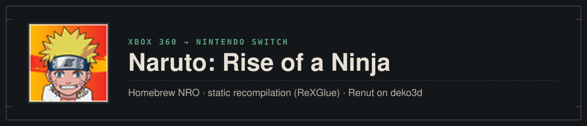
</p>

<p align="center">
  <b>English</b> · <a href="README_ru.md">Русский</a>
</p>

<p align="center">
  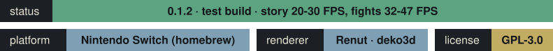
</p>

A Nintendo Switch (homebrew NRO) port of **Naruto: Rise of a Ninja** (Ubisoft Montreal, 2007, Xbox 360 exclusive).
The game's PowerPC code is statically recompiled with [ReXGlue](https://github.com/rexglue/rexglue-sdk); the Xbox 360 GPU is not
emulated: Direct3D calls are drawn by Renut, a Direct3D-level renderer, on deko3d, the Switch's native graphics API.

> [!IMPORTANT]
> **[Version 0.1.2](https://github.com/malinkin-s/naruto-rise-of-a-ninja-nx/releases/tag/v0.1.2) is a test
> build.** The story mode and fights play on a real console, but expect bugs and crashes. The game's files are not
> included: you need your own copy of the game (installation: [the release page](https://github.com/malinkin-s/naruto-rise-of-a-ninja-nx/releases/tag/v0.1.2)).

## Status

**Version 0.1.2, 2026-10-28.** Measured on a Nintendo Switch. Two sets of figures: stock clocks (handheld, CPU 1020 MHz,
GPU 460 MHz; the 0.1.1 measurements, not repeated for 0.1.2) and the console overclocked by hand (CPU 1785 MHz, GPU 768 MHz).

| Area | Switch | Notes |
|---|---|---|
| Boot, logos, menus | **Works** | 24–29 FPS in menus |
| Story mode (Konoha, the open world) | **Works** | stock clocks: about 20 FPS (the game's logic runs at 30). CPU 1785 / GPU 768 MHz: 27–30 FPS, the heaviest spot of the village 27–28 FPS; ground shadows fixed |
| Fights | **Works** | 32–47 FPS at 1280×720, 46–58 FPS at 854×480 (fights run at 60) |
| Saves on the SD card | **Works** | Created, listed and loaded |
| Bink video (cutscenes) | **Works** | The intro and the first story scenes; not checked through the whole game |
| Controller | **Works** | Played by hand in the story mode |
| Settings (`naruto.toml`) | **Works** | Render resolution handheld / docked, the game's anti-aliasing |
| Audio | Plays | With the fourth CPU core (below) no audio lag in Konoha; on three cores it stutters when the frame rate drops |
| Fourth CPU core | **Works** | Needs a HOME Menu forwarder started with 4 cores; +0.5–1.2 FPS in the heavy spot, smoother play, clean sound |
| Character DLC (3 extra engines) | Not yet | |
| Known issues | | Possible crashes when quitting; the "Saved Game Warning" scroll border differs from the Xbox 360 |

Performance so far: sa2-nx's enhancements, an optimised code generator (registers as locals, direct calls, guest
memory without volatile, float-mode switches skipped), store cards for Renut's caches, a batched draw queue without
allocations, and (new in 0.1.2) the use of a **fourth CPU core** when the game is started with four. In the open world
all three heavy threads (the game's main thread, its drawing thread and Renut's render thread) sit at 80–95 % of a core;
the render thread (about 34 ms a frame at the heaviest spot) is the limit. Next: moving part of its work to the free
core (an experimental option is in 0.1.2, off by default: `naruto_deko3d_record_worker`).

#### Four CPU cores (optional)

A Switch game normally runs on three of the four cores; the fourth is shared with the system. With four cores the
audio mixer, the XMA decoder and the game's thread pool move to it and stop competing with the game's heavy threads.
The core count is chosen by the launcher, so this needs a HOME Menu forwarder: install [Sphaira](https://github.com/ITotalJustice/sphaira),
select `naruto.nro`, install a forwarder with **CPU cores = 4** and **address space = 39-bit**, and start the game from
the new HOME Menu icon. Check `process cores 4 (mask 0xF)` in `logs/rex/rex_profile.log`. Started from hbmenu the port
works as before, on three cores. The fourth core is shared with the HOME Menu, overlays and background services:
please report anything odd in long sessions.

### What was solved to get here

- **Older Direct3D than any earlier Renut port** (XDK 2.0.6274, LTCG): the private device layout, functions and
  offsets were mapped using the PC recompilation's renderer as a reference ([docs/d3d-census.md](docs/d3d-census.md),
  [docs/renut-retarget.md](docs/renut-retarget.md)).
- **3,322 game shaders** from `xeshader.sdb` translated (XenosRecomp → DXC → SPIRV-Cross → uam for deko3d).
- **Tiled rendering**: the game draws its 3D scene in three 1280×256 tiles with 4× MSAA (the Xbox 360's EDRAM);
  Renut's targets now cover all tiles.
- **The game engine `ai2c.dll`** is linked into the NRO as a static module.
- **Automated console tests over nxlink** (`tools/switch/nxtest.sh`): the game runs for a set time, sends its log,
  renderer frames, its profile and crash reports to the PC, and exits by itself.
- **Ground shadows**: the game's polygon offset (depth bias) was ignored by Renut, which cut decal shadows into wedges.

The full story, with evidence for every step, is in [docs/port-journal.md](docs/port-journal.md).

## Screenshots

Taken from the renderer on a Nintendo Switch (half size, 640×360), version 0.1.0 at stock clocks.

<table>
  <tr>
    <td>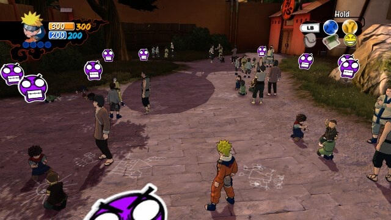</td>
    <td>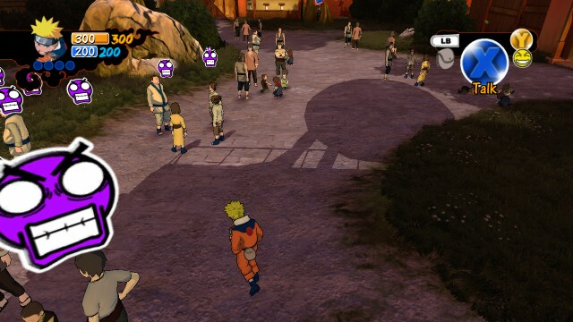</td>
  </tr>
  <tr>
    <td align="center"><sub>Story mode: Konoha</sub></td>
    <td align="center"><sub>The village plaza</sub></td>
  </tr>
  <tr>
    <td>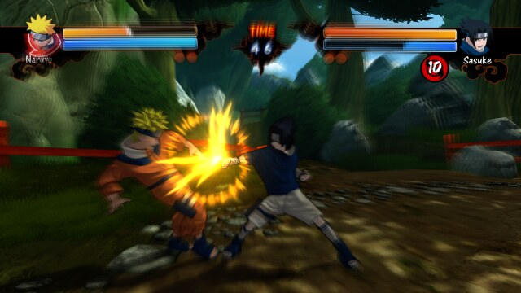</td>
    <td>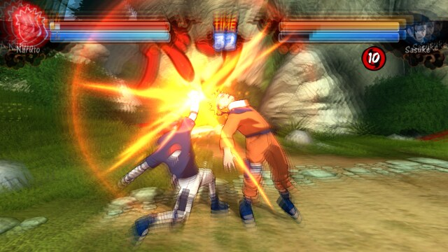</td>
  </tr>
  <tr>
    <td align="center"><sub>Naruto vs Sasuke</sub></td>
    <td align="center"><sub>A combo</sub></td>
  </tr>
  <tr>
    <td>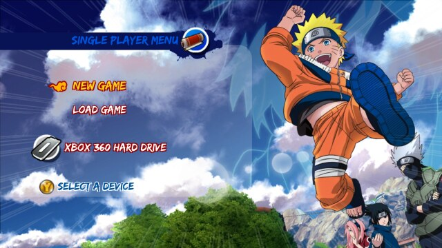</td>
    <td>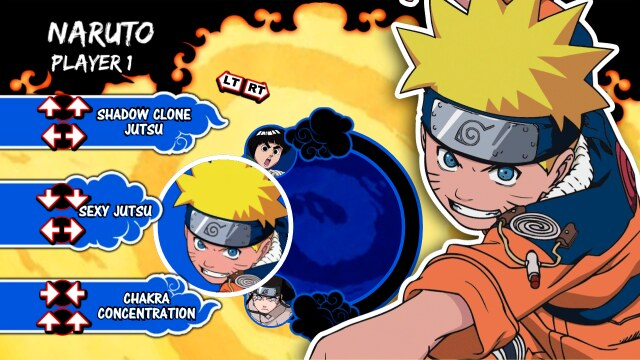</td>
  </tr>
  <tr>
    <td align="center"><sub>Single player menu</sub></td>
    <td align="center"><sub>Jutsu list before a fight</sub></td>
  </tr>
  <tr>
    <td>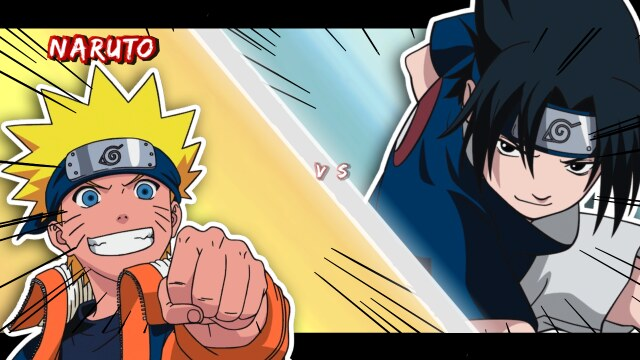</td>
    <td>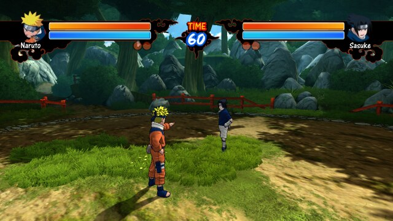</td>
  </tr>
  <tr>
    <td align="center"><sub>Match intro</sub></td>
    <td align="center"><sub>The forest arena</sub></td>
  </tr>
  <tr>
    <td>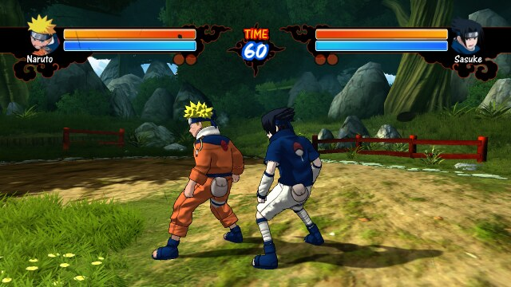</td>
    <td>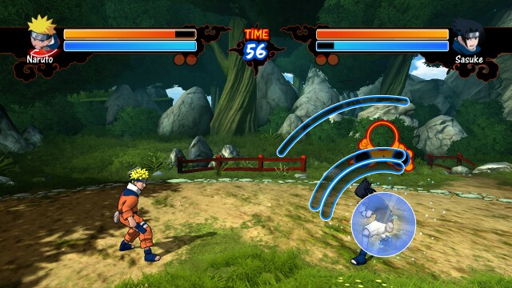</td>
  </tr>
  <tr>
    <td align="center"><sub>Naruto and Sasuke</sub></td>
    <td align="center"><sub>A jutsu prompt</sub></td>
  </tr>
  <tr>
    <td>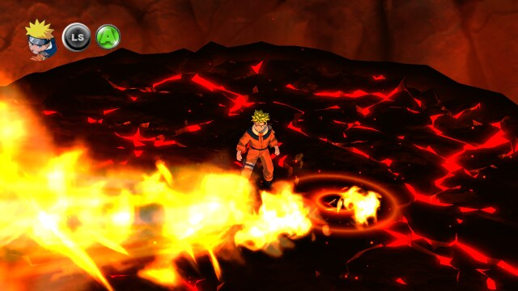</td>
    <td>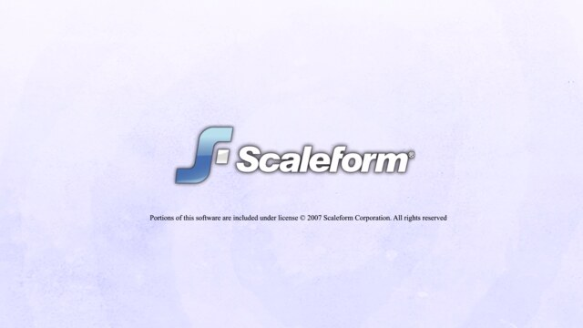</td>
  </tr>
  <tr>
    <td align="center"><sub>Jutsu cut-in</sub></td>
    <td align="center"><sub>Boot logos</sub></td>
  </tr>
</table>

## How it is built

| Part | From |
|---|---|
| Recompiled code | ReXGlue SDK, the [sa2-nx](https://github.com/ChanseyIsTheBest/sa2-nx) fork (Horizon layer, static guest modules) |
| PC base and reference | [jorjbarbosa/naruto-rise-recomp](https://github.com/jorjbarbosa/naruto-rise-recomp): seeds, hooks, the Direct3D map |
| Renderer | Renut (masterspike52) on plume's deko3d back end, from sa2-nx, retargeted to Naruto's Direct3D |
| Toolchain | devkitA64 (GCC 16.1) in Docker, libnx, deko3d |

### Installing

Through the installer page, which makes the game's shaders from your own disc: **https://malinkin-s.github.io/naruto-nx-installer/**. The steps are on [the 0.1.2 release page](https://github.com/malinkin-s/naruto-rise-of-a-ninja-nx/releases/tag/v0.1.2).

### Building (outline)

You need your own game files in `game/` (the extracted disc, `default.xex` at the top).

```bash
python3 tools/fetch_thirdparty.py           # SDK third-party sources
tools/fetch_renut_deps.sh                   # plume, XenosRecomp, uam, imgui (from sa2-nx)
# host rexglue (sdk/, cmake --preset linux-amd64), then:
rexglue codegen app/naruto_manifest.toml    # recompiled code into app/generated/ (never committed)
tools/deko3d_build_tools.sh                 # SPIRV-Cross and uam for the shader chain
tools/switch/host_shaders.sh                # Renut's own shaders for deko3d
tools/switch/build.sh                       # out/nx/naruto.nro
tools/switch/package.sh                     # out/nx/sdcard/ -> copy to the SD card
```

On the console, start hbmenu with title override (hold R while starting a game, for the full memory) and pick
Naruto: Rise of a Ninja.

## Credits

- [jorjbarbosa/naruto-rise-recomp](https://github.com/jorjbarbosa/naruto-rise-recomp): the PC recompilation this
  port stands on.
- [sa2-nx](https://github.com/ChanseyIsTheBest/sa2-nx): the Switch template, the SDK fork and Renut on deko3d.
- Renut by masterspike52; plume; XenosRecomp; uam; deko3d and libnx by the devkitPro and switchbrew teams.
- The [ReXGlue SDK](https://github.com/rexglue/rexglue-sdk).

## License and disclaimer

GPL-3.0, see [LICENSE](LICENSE). This is a fan project, not affiliated with or endorsed by Ubisoft, Bandai Namco,
Shueisha, Microsoft or Nintendo. *Naruto* and the game's assets belong to their owners. No game files are
distributed here: build it from a copy of the game you own.
