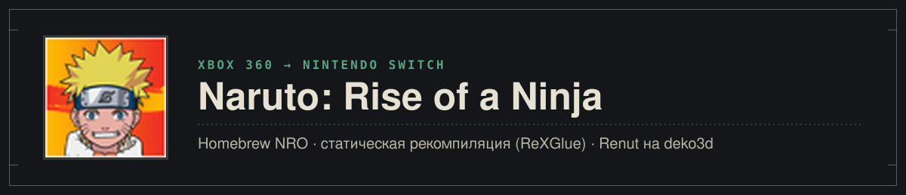
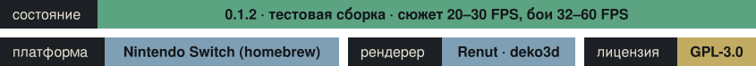

<p align="center">
  
</p>

<p align="center">
  <a href="README.md">English</a> · <b>Русский</b>
</p>

<p align="center">
  
</p>

Порт **Naruto: Rise of a Ninja** (Ubisoft Montreal, 2007, эксклюзив Xbox 360) на Nintendo Switch в виде homebrew NRO.
PowerPC-код игры статически перекомпилирован с [ReXGlue](https://github.com/rexglue/rexglue-sdk). GPU Xbox 360 не эмулируется:
вызовы Direct3D рисует Renut, рендерер уровня Direct3D, на deko3d — родном графическом API Switch.

> [!IMPORTANT]
> **[Версия 0.1.3](https://github.com/malinkin-s/naruto-rise-of-a-ninja-nx/releases/tag/v0.1.3) — играбельная,
> но всё ещё тестовая сборка.** Сюжетный режим и бои играются на настоящей консоли; нужно дальнейшее тестирование, чтобы
> выявить баги, вылеты и прочее. Файлов игры в сборке нет: нужна своя копия игры (установка —
> [на странице релиза](https://github.com/malinkin-s/naruto-rise-of-a-ninja-nx/releases/tag/v0.1.3)).

## Состояние

**Версия 0.1.3, 2026-10-29.** Замеры на Nintendo Switch в портативе, два набора цифр: стандартные частоты (CPU 1020 МГц,
GPU 460 МГц; замеры 0.1.1, не повторялись) и консоль, разогнанная вручную (CPU 1785 МГц, GPU 768 МГц), с разрешением
рендера 480p (`sa2_render_height_handheld = 480`): на этом режиме игра сейчас играется хорошо.

| Что | Switch | Подробности |
|---|---|---|
| Запуск, логотипы, меню | **Работает** | 24–29 FPS в меню |
| Сюжетный режим (Коноха, открытый мир) | **Работает** | CPU 1785 / GPU 768 МГц, 480p: около 30 FPS (родная частота открытого мира) с редкими просадками, в той части деревни, где играли. Стандартные частоты: около 20 FPS (0.1.1). Тени на земле исправлены |
| Бои | **Работают** | CPU 1785 / GPU 768 МГц, 480p: 60 FPS (родная частота боёв) с редкими просадками. Стандартные частоты: 32–47 FPS в 1280×720, 46–58 FPS в 854×480 (0.1.1) |
| Сохранения на SD-карте | **Работают** | Создаются, видны в списке, загружаются |
| Видео Bink (ролики) | **Работает** | Вступление и первые сюжетные сцены; вся игра не проверена |
| Геймпад | **Работает** | Сюжетный режим пройден руками |
| Настройки (`naruto.toml`) | **Работают** | Разрешение рендера отдельно для портатива и дока (`sa2_render_height_handheld` / `sa2_render_height_docked`: 480, 720 или 1080; по умолчанию 720, 480 быстрее), сглаживание самой игры. Файл создаётся рядом с NRO при первом запуске |
| Звук | Играет | С четвёртым ядром CPU (ниже) в Конохе без лагов; на трёх ядрах заикается, когда падает частота кадров |
| Четвёртое ядро CPU | **Работает** | Нужен форвардер в HOME-меню с 4 ядрами; +0.5–1.2 FPS в тяжёлом месте, игра плавнее, звук чистый |
| DLC с персонажами (3 доп. движка) | Пока нет | |
| Известные проблемы | | Возможны вылеты при выходе. Играбельно, но нужно больше тестирования, чтобы найти баги и вылеты: пишите, с чем столкнётесь |

Что уже сделано для скорости: улучшения sa2-nx, оптимизированный генератор кода (регистры как локальные переменные,
прямые вызовы, память гостя без volatile, пропуск переключений режима FPU), store cards для кэшей Renut, пакетная очередь
draw'ов без аллокаций, использование **четвёртого ядра CPU**, если игра запущена с четырьмя (0.1.2), и, новое в 0.1.3,
сборка, оптимизированная по профилю сеанса на консоли (PGO), с оптимизацией на этапе линковки (LTO): при той же нагрузке
сцены render thread тратит примерно на 21% меньше процессорного времени на кадр, чем в обычной сборке 0.1.2 (замер при
3500 draw'ах на кадр). Профиль лежит в [pgo/](pgo/) (только счётчики ветвлений). Вынос записи команд рендерера на
свободное ядро (экспериментальная опция `naruto_deko3d_record_worker`, по умолчанию выключена) измерен и работает
медленнее, поэтому остаётся выключенным.

#### Четыре ядра CPU (по желанию)

Игра на Switch обычно работает на трёх ядрах из четырёх; четвёртое делится с системой. С четырьмя ядрами звуковой
микшер, декодер XMA и пул потоков игры переезжают на него и не мешают тяжёлым потокам. Число ядер выбирает загрузчик,
поэтому нужен форвардер в HOME-меню: поставьте [Sphaira](https://github.com/ITotalJustice/sphaira), выберите
`naruto.nro`, установите форвардер с **CPU cores = 4** и **address space = 39-bit** и запускайте игру значком из
HOME-меню. Проверка: в `logs/rex/rex_profile.log` должно быть `process cores 4 (mask 0xF)`. Из hbmenu порт работает как
раньше, на трёх ядрах. Четвёртое ядро делится с HOME-меню, оверлеями и фоновыми службами: пишите, если в долгих сеансах
заметите странности.

### Что пришлось решить

- **Direct3D старше, чем в любом прежнем порте на Renut** (XDK 2.0.6274, LTCG): приватная раскладка устройства,
  функции и смещения найдены по рендереру PC-рекомпиляции ([docs/d3d-census.md](docs/d3d-census.md),
  [docs/renut-retarget.md](docs/renut-retarget.md)).
- **3 322 шейдера игры** из `xeshader.sdb` переведены цепочкой XenosRecomp → DXC → SPIRV-Cross → uam для deko3d.
- **Тайловый рендеринг**: 3D-сцена рисуется тремя тайлами 1280×256 с 4× MSAA (EDRAM Xbox 360); цели Renut теперь
  покрывают все тайлы.
- **Движок игры `ai2c.dll`** влинкован в NRO статическим модулем.
- **Автотесты на консоли через nxlink** (`tools/switch/nxtest.sh`): игра работает заданное время, шлёт на PC лог,
  кадры рендерера, профиль и отчёты о падениях и сама выходит.
- **Тени на земле**: Renut игнорировал сдвиг глубины (depth bias) игры и резал тени-декали на клинья.

Полная история с доказательствами каждого шага — в [docs/port-journal.md](docs/port-journal.md) (на английском).

## Скриншоты

Сняты с рендерера на Nintendo Switch (половинный размер, 640×360), версия 0.1.0 на стандартных частотах.

<table>
  <tr>
    <td></td>
    <td></td>
  </tr>
  <tr>
    <td align="center"><sub>Сюжетный режим: Коноха</sub></td>
    <td align="center"><sub>Площадь деревни</sub></td>
  </tr>
  <tr>
    <td></td>
    <td></td>
  </tr>
  <tr>
    <td align="center"><sub>Наруто против Саске</sub></td>
    <td align="center"><sub>Комбо</sub></td>
  </tr>
  <tr>
    <td></td>
    <td></td>
  </tr>
  <tr>
    <td align="center"><sub>Меню одиночной игры</sub></td>
    <td align="center"><sub>Список техник перед боем</sub></td>
  </tr>
  <tr>
    <td></td>
    <td></td>
  </tr>
  <tr>
    <td align="center"><sub>Заставка матча</sub></td>
    <td align="center"><sub>Лесная арена</sub></td>
  </tr>
  <tr>
    <td></td>
    <td></td>
  </tr>
  <tr>
    <td align="center"><sub>Наруто и Саске</sub></td>
    <td align="center"><sub>Подсказка техники</sub></td>
  </tr>
  <tr>
    <td></td>
    <td></td>
  </tr>
  <tr>
    <td align="center"><sub>Вставка техники</sub></td>
    <td align="center"><sub>Логотипы при запуске</sub></td>
  </tr>
</table>

## Из чего собран

| Часть | Откуда |
|---|---|
| Перекомпилированный код | ReXGlue SDK, форк [sa2-nx](https://github.com/ChanseyIsTheBest/sa2-nx) (слой Horizon, статические гостевые модули) |
| PC-основа и справочник | [jorjbarbosa/naruto-rise-recomp](https://github.com/jorjbarbosa/naruto-rise-recomp): seeds, хуки, карта Direct3D |
| Рендерер | Renut (masterspike52) на deko3d-бэкенде plume, из sa2-nx, перенацелен на Direct3D Naruto |
| Тулчейн | devkitA64 (GCC 16.1) в Docker, libnx, deko3d |

### Установка

Через страницу-установщик, которая делает шейдеры игры из вашего диска: **https://malinkin-s.github.io/naruto-nx-installer/**. Шаги — на [странице релиза 0.1.2](https://github.com/malinkin-s/naruto-rise-of-a-ninja-nx/releases/tag/v0.1.2).

### Сборка (в общих чертах)

Нужны свои файлы игры в `game/` (распакованный диск, `default.xex` в корне).

```bash
python3 tools/fetch_thirdparty.py           # сторонние исходники SDK
tools/fetch_renut_deps.sh                   # plume, XenosRecomp, uam, imgui (из sa2-nx)
# собрать хостовый rexglue (sdk/, cmake --preset linux-amd64), затем:
rexglue codegen app/naruto_manifest.toml    # перекомпилированный код в app/generated/ (не коммитится)
tools/deko3d_build_tools.sh                 # SPIRV-Cross и uam для цепочки шейдеров
tools/switch/host_shaders.sh                # служебные шейдеры Renut для deko3d
tools/switch/build.sh                       # out/nx/naruto.nro
tools/switch/package.sh                     # out/nx/sdcard/ -> скопировать на SD-карту
```

На консоли запустите hbmenu в режиме title override (удерживая R при запуске игры — для полной памяти) и выберите
Naruto: Rise of a Ninja.

## Благодарности

- [jorjbarbosa/naruto-rise-recomp](https://github.com/jorjbarbosa/naruto-rise-recomp) — PC-рекомпиляция, на которой
  стоит порт.
- [sa2-nx](https://github.com/ChanseyIsTheBest/sa2-nx) — шаблон для Switch, форк SDK и Renut на deko3d.
- Renut (masterspike52); plume; XenosRecomp; uam; deko3d и libnx от команд devkitPro и switchbrew.
- [ReXGlue SDK](https://github.com/rexglue/rexglue-sdk).

## Лицензия и оговорка

GPL-3.0, см. [LICENSE](LICENSE). Фанатский проект, не связан с Ubisoft, Bandai Namco, Shueisha, Microsoft и Nintendo
и не одобрен ими. *Naruto* и материалы игры принадлежат их владельцам. Файлы игры здесь не распространяются: соберите
порт из своей копии игры.
