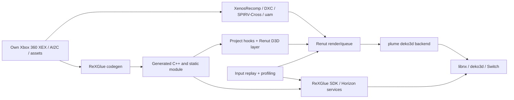

# Subsystem Map and Ownership

Ownership here means who controls the implementation in this tree, not legal authorship. **Fact** means source inspection or cited historical evidence; **unknown** needs a run or deeper code audit. Candidate actions are not rewrite approvals. Historical behavior: `README_ru.md` §State; design history: `docs/port-journal.md` §Decisions and `docs/renut-retarget.md`.

| Subsystem | Main paths; owner | Target API / dependency | Status, evidence, problem | Candidate action; required proof |
|---|---|---|---|---|
| PPC → C++ | `app/naruto_manifest.toml`, `app/codegen_flavor.toml`, `tools/post_codegen.sh` (project); `sdk/src/codegen/` (ReXGlue fork) | Xbox 360 PPC semantics → host C++ | Base code runs historically (`README_ru.md` §State); generated tree is local | Keep/adapt; prove a miscompile with matching PC/Switch replay and instruction trace before generator change |
| CPU / scheduling | `sdk/src/system/xthread.cpp` (ReXGlue fork); `app/src/cpu/` (project) | Horizon threads/cores | Four-core benefit reported (`docs/archive/HANDOFF.md` §Architecture); current per-thread baseline unknown | Investigate measured thread saturation, waits and affinity before adaptation |
| Memory / address space | `sdk/src/system/xmemory.cpp`, Switch guest memory (ReXGlue fork); `app/naruto_switch_defaults.toml` (project) | 39-bit process and Horizon memory limit | Long-session behavior unknown; 1 GB cache concern historical (`docs/archive/release-0.1.3.md` §Known issues) | Profile peak/fragmentation; no rewrite from TODO comments |
| D3D-level frontend | `app/src/renut_engine/gpu/d3d/` (vendored Renut with project hooks) | Xbox D3D device state | Retargeted to XDK 6274 (`docs/renut-retarget.md`); visual coverage incomplete | Adapt specific hook/state with captured failing frame |
| Render queue / draw | `app/src/renut_engine/gpu/backend/`, `render/` (vendored Renut plus project changes) | plume renderer | 0.1.4 culling gain reported (`docs/culling-solutions-log.md`); current run unknown | Attribute time per stage in same scene before architecture change |
| GPU and game shaders | `tools/deko3d_*`, `tools/renut_*`, `app/src/renut_engine/gpu/shaders/` (project/vendored tools) | XenosRecomp, DXC, SPIRV-Cross, uam | Shader chain documented (`README_ru.md` §What was solved); exact package identity unknown | Compare shader variant, GPU time and image; adapt only failing stage |
| Switch graphics backend | plume dependency and `app/src/renut_engine/gpu/banjo_renut_deko3d.*` (third party / local integration) | deko3d, libnx/devkitPro | Reported working (`README_ru.md` §Components); backend revision not inventoried | Replace backend only after reproducible API limitation and alternative prototype |
| Files / loading | `sdk/src/system/xfile.cpp`, `app/src/naruto_app.h` (ReXGlue fork / project) | SD filesystem, guest paths | Saves/load reported working (`README_ru.md` §State); cache growth concern | Measure latency/hit rate/memory on fixed load |
| Audio / Bink video | SDK audio and video paths (ReXGlue fork / third-party codecs) | Switch audio, FFmpeg/Bink | Early video/audio works historically; three-core stutter reported (`README_ru.md` §State) | Count underruns and isolate mixer/decode vs scheduling |
| Input | `sdk/src/input/input_system.cpp`, `sdk/src/input/switch/switch_input_driver.cpp` (ReXGlue fork) | libnx HID | Controls work historically; two replay formats differ (source files) | Reconcile clocks/formats with checkpoint-matched runs |
| Services / timers / sync | `sdk/src/system/`, `sdk/src/ui/switch_perf.cpp` (ReXGlue fork) | Horizon/libnx | Exit crash possible; root cause unknown (`README_ru.md` §State) | Capture symbolized crash + lifecycle trace |
| Build / installer | `app/CMakeLists.txt`, `tools/switch/`, `tools/deko3d_*` (project); external installer (separate repository) | CMake, Docker, devkitA64 | Build scripts present; clean reproduction unknown (`docs/archive/HANDOFF.md` §Build and test) | Pin digests and compare NRO/hash/manifest |
| Telemetry / replay | `app/src/renut_engine/perf/`, `sdk/src/ui/switch_perf.cpp`, `tools/pc/`, `tools/switch/ftp_run_summary.py` (mixed) | On-console counters, FTP log retrieval | FPS/GPU/thread data exist in installed 0.1.4; new opt-in segment interval summary and memory-only FTP collector compile/parse locally but lack a console run; independent simulation clock and route checks remain absent (`frame_stats.cpp`, `switch_perf.cpp`, `ftp_run_summary.py`) | Validate a new build and measure telemetry overhead; then add only the missing critical-path or game-clock signals needed by a named scenario |

## Boundary and escalation rule

Project-owned glue/config/hooks can be changed locally with a measured task. Generic ReXGlue or Renut fixes should be isolated, regression-tested and proposed upstream where applicable; local game-specific address/layout changes remain local (`docs/port-journal.md` §Decisions). Do not rewrite codegen, memory, scheduler, renderer, shader toolchain, audio or input until a named scenario demonstrates a failure, a profile locates it, API adaptation is evaluated, and an ADR compares alternatives. Reverse engineering is needed for unknown guest structures/semantics (`docs/re-index.md`, `docs/d3d-census.md`); a known host API mismatch needs adaptation and a regression test instead.
